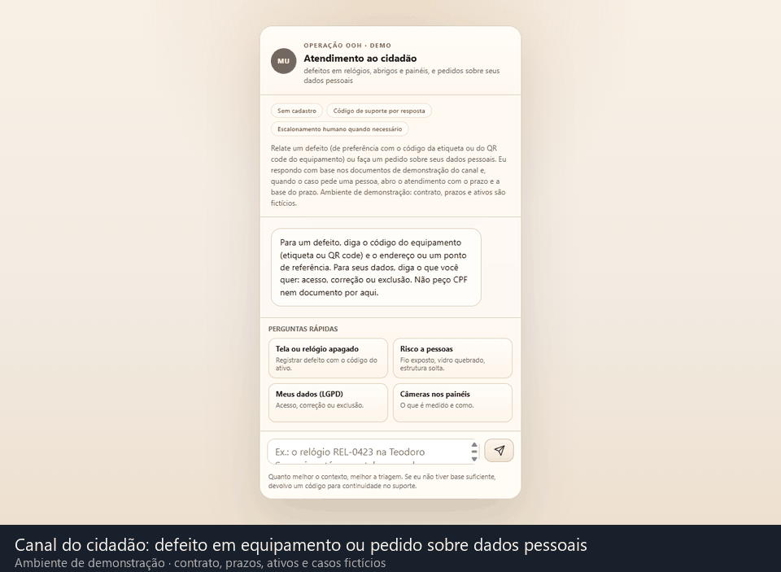

# concession

Atendimento com RAG para operacao de concessoes de mobiliario urbano e midia
exterior: registra defeitos com o prazo do contrato, atende o titular de dados
com o prazo da LGPD e coloca os dois na mesma fila auditada do time.

> **Ambiente de demonstracao.** Contrato, prazos de manutencao, inventario de
> ativos e aviso de privacidade sao ficticios e estao marcados como tal em cada
> arquivo. Nao representam nenhuma empresa real. O nucleo vem do
> `supportFAQagent`, um agente de suporte cujos planos e runbooks de staging
> ficaram no repositorio de origem (ver `docs/archive/README.md`).

**English:** [summary in English](#english-summary) ·
[system card](docs/system-card.md).



*Demo de 55 s gravada localmente, sem chave de LLM, com o banco descartavel
(`docker-compose.test.yml`) e o seed de casos ficticios
(`scripts/seed_demo_cases.py`). Sem LLM, a resposta automatica e o fallback
seguro; a orientacao de seguranca, a classificacao, a prioridade e o prazo nao
dependem do modelo.*

## O problema

Uma concessao de mobiliario urbano vive de prazos que nao sao do time:

- **Prazo do contrato.** Um relogio de rua apagado ou um abrigo com vidro
  quebrado tem prazo de atendimento no anexo de niveis de servico. Perder o
  prazo e risco de penalidade e de desgaste na renovacao, e tela apagada e
  veiculacao que deixa de ser entregue.
- **Prazo da lei.** Um cidadao que pergunta "voces estao me filmando?" ou pede
  acesso aos seus dados tem direito a declaracao completa em ate 15 dias (LGPD
  art. 19, II). Para exclusao ou correcao, o prazo segue regulamento (art. 18,
  §5º); nesta demo, o caso usa os mesmos 15 dias como meta interna.
- **Prova.** Nos dois casos, quem fiscaliza quer ver quando o pedido chegou,
  qual prazo valia e quem tratou.

## O que este projeto faz

```text
Cidadao, tecnico ou fiscal (WhatsApp ou web)
  -> roteador de dominio (manutencao | privacidade)
  -> retrieval na base do dominio (anexo de SLA, aviso de privacidade)
  -> resposta com as fontes recuperadas, ou fallback seguro
  -> regra do dominio classifica o pedido (ex.: fio exposto = risco_seguranca)
  -> ticket com prioridade (urgent | high | normal | low)
  -> semaforo de SLA com o prazo e a base do prazo (clausula ou artigo)
```

| Dominio | Exemplo | Classificacao | Prazo no console | Base |
| --- | --- | --- | --- | --- |
| `concessoes-manutencao` | "Fio exposto soltando faisca no abrigo ABR-1104" | `risco_seguranca` -> urgent | 4h | Anexo de SLA (demo), item 3.1 |
| `concessoes-manutencao` | "O relogio REL-0423 esta com a tela apagada" | `tela_inoperante` -> high | 24h | Anexo de SLA (demo), item 3.2 |
| `concessoes-manutencao` | "Picharam o relogio da Praca da Se" | `conservacao_limpeza` -> low | 5 dias | Anexo de SLA (demo), item 3.4 |
| `lgpd-titular` | "Quero saber quais dados voces tem" | `pedido_titular` -> normal | 15 dias | LGPD art. 19, II |
| `lgpd-titular` | "Quero excluir meus dados" | `pedido_titular` -> normal | 15 dias | meta interna (demo); prazo legal segue regulamento (art. 18, §5º) |
| `lgpd-titular` | "Acho que meus dados vazaram" | `incidente_dados` -> urgent | 4h | meta interna (demo) |

O mesmo motor de SLA atende um prazo de contrato (horas) e um prazo legal
(dias). Cada dominio declara os seus no proprio `domain.yaml`, sem codigo
novo no nucleo.

## O que ja funciona

- **Dois dominios novos**, com base de conhecimento, prompts e evals:
  `concessoes-manutencao` e `lgpd-titular`.
- **SLA por dominio**: bloco `sla:` no `domain.yaml` sobrescreve o SLA global;
  a origem do prazo (`basis`) aparece em cada caso do console.
- **Prioridade por tipo de pedido**: `escalation_rules[].priority` define a
  prioridade do ticket; quando varias regras casam, vale a maior.
- **Orientacao de seguranca fixa**: `escalation_rules[].notice` poe um texto
  fixo antes de qualquer resposta, com ou sem LLM (risco a pessoas: afastar-se
  e ligar 193; incidente de dados: triagem em 4 horas e o canal nunca pede
  senha; notificacao da fiscalizacao: resposta em 24 horas, sem valor de
  multa).
- **Mascaramento de dados pessoais**: CPF com digito verificador, cartao
  (Luhn), e-mail, telefone e IP saem mascarados antes de persistir e antes de a
  pergunta ir ao provedor de LLM e de embeddings; datas ISO e protocolos com
  rotulo ficam legiveis para a trilha de auditoria.
- **Evals que cobrem a classificacao** (26 casos base, 13 por dominio, com
  casos negativos): `required_handoff_reasons` exige que "fio exposto" levante
  `risco_seguranca`, e nao so que nada inesperado apareca.
- **Relatorio mensal para a fiscalizacao**: CSV com um caso por linha, o
  prazo gravado na abertura (editar o `domain.yaml` depois nao reescreve
  casos abertos), o resultado contra o prazo e o motivo do atraso, que e
  obrigatorio ao fechar depois do prazo e vem de uma lista fechada. Sem dado
  pessoal. Botao "Baixar CSV" na `/team`.
- **Tela do cidadao (`/chat-ui`)**: aviso da regra como alerta, cartao
  "Chamado registrado" com protocolo, prioridade, prazo e base, e as fontes
  consultadas pelo titulo. Nenhum codigo interno aparece para o cidadao.
- **Tela da fila do time (`/team`)**: pagina estatica, somente leitura, com o
  login OTP staff existente, fila em ordem de atencao, semaforo com rotulo em
  texto, prazo no fuso America/Sao_Paulo, base do prazo, filtros por dominio e
  cor e atualizacao a cada 60 s. Ligada por padrao em desenvolvimento
  (`ENABLE_TEAM_UI`); sem a API do console, mostra "Console indisponivel".
  Para a demo local, `ENABLE_TEAM_DEV_LOGIN=true` entra como o operador
  ficticio do seed sem OTP; so funciona com `APP_ENV=development` explicito,
  pedido vindo de loopback e nenhum header de proxy.
- **Do nucleo herdado**: API FastAPI, roteamento de dominio por mensagem,
  retrieval lexical ou pgvector, provider OpenAI ou Anthropic com fallback
  seguro, handoff com taxonomia, ticket duravel com console de SLA e
  transicoes auditadas, OTP via WhatsApp com consentimento LGPD, mascaramento
  de cartao, CNPJ, e-mail, telefone e IP antes de persistir, `request_id` em
  toda resposta.

## Status

| Item | Estado |
| --- | --- |
| Testes automatizados (`python -m pytest`) | 1225 passam, 51 pulados (integracao PostgreSQL: rodam contra banco real no job `postgres` do Phase 0 Gates) |
| Evals `concessoes-manutencao` (base + confinamento) | 30/30, com 3 casos negativos de precisao |
| Evals `lgpd-titular` (base + confinamento) | 29/29, com 3 casos de precisao e injecao |
| Evals do dominio de referencia `suporte-vps-whatsapp` | 20/20 |
| Gravacao da prioridade no ticket contra PostgreSQL real | verificada: `tests/integration/test_demo_seed_console_postgres.py` grava pelo `record_chat` e le pela API do console, no job `postgres` do Phase 0 Gates |
| Tela web do console (`/team`) | somente leitura: fila, semaforo e filtros; assumir/fechar seguem pela API |
| Chat com LLM real | exige `OPENAI_API_KEY`; sem chave, responde com o fallback seguro |

Os evals rodam sem chave de LLM. Nesse modo, eles validam retrieval,
fontes recuperadas (`references`), classificacao e escalonamento, mas nao a
qualidade do texto gerado pelo modelo nem o que ele de fato cita.

### Evals com LLM real (opt-in, nao e gate): 21/26 na linha de base, 26/26 depois da correcao

O modo `--provider-mode real` mede o texto do modelo: falha com
`provider_error`, cobra termos, prazos permitidos e citacao do item ou artigo,
e repete cada caso `--runs` vezes. Comando e metricas em
[docs/architecture/domain-evals.md](docs/architecture/domain-evals.md#modo-llm-real-opt-in-nao-e-gate).

```bash
python -m app.evals.run_domain_eval concessoes-manutencao lgpd-titular \
  --provider-mode real --runs 3 --report reports/eval-real.json
```

Linha de base medida antes de qualquer ajuste de prompt: 21 de 26 casos
passam nas 3 rodadas. Nenhuma chamada falhou (69/69), e fontes recuperadas e
motivos de encaminhamento passaram em todos os casos. As 5 falhas:

- **Defeito sem regra nao vira caso** (`negativo-sem-risco-nao-e-urgente`,
  `negativo-tecnico-atrasado`, 0/3): com o LLM respondendo com confianca, um
  defeito que nao casa nenhuma regra ("banco solto, sem risco") nao e
  encaminhado e nao entra na fila. Sem LLM, o fallback encaminha por baixa
  confianca, e isso ficava escondido.
- **Prazo errado ou ausente** (`suspeita-vazamento`, `notificacao-fiscalizacao`,
  0/3): o modelo diz 15 dias para suspeita de vazamento (a base diz triagem em
  4 horas) e nao informa as 24 horas da notificacao da fiscalizacao.
- **Citacao instavel** (`relogio-hora-errada`, 2/3): uma rodada nao cita o
  item 3.3.

A correcao mexeu so no `domain.yaml` dos dois dominios, sem codigo novo no
nucleo: regras `defeito_geral` (item 3.3) e `cobranca_atendimento`, `notice`
com o prazo fixo na notificacao da fiscalizacao (24 horas) e no incidente de
dados (4 horas), orientacao que separa os 15 dias do titular do prazo de
incidente e pedido explicito do numero do item do anexo. Os evals sem LLM
passaram a exigir os dois prazos e os motivos novos.

| Campo | Linha de base | Depois da correcao |
| --- | --- | --- |
| Modelo (`model`) | `gpt-4o-mini-2024-07-18` (OpenAI) | `gpt-4o-mini-2024-07-18` (OpenAI) |
| Data (`timestamp_utc`) | 2026-11-27 05:01 UTC | 2026-11-27 05:49 UTC |
| Temperatura (`temperature`) | 0.0 | 0.0 |
| Rodadas (`runs`) | 3 | 3 |
| Commit (`git_commit`) | `3326b79` (arvore limpa) | `3386ca6` (arvore limpa) |
| `concessoes-manutencao` pass@all / taxa media | 9/13 (69%) / 74% | 13/13 (100%) / 100% |
| `lgpd-titular` pass@all / taxa media | 12/13 (92%) / 92% | 13/13 (100%) / 100% |
| Prazos alucinados (`allowed_durations` passed/total) | 21/24; as 3 falhas sao "15 dias" em `suspeita-vazamento` | 24/24 |
| Tokens (`usage.total_tokens`) | 141.151 em 69 chamadas | 142.591 em 69 chamadas |
| Custo (calculado a parte; o relatorio nao estima) | nao estimado | nao estimado |

26/26 com 3 rodadas e um modelo nao e garantia: o modo real continua opt-in e
fora da CI, e vale rodar de novo ao trocar modelo, prompt ou base.

## Rodando localmente

```bash
python -m venv .venv
.venv/Scripts/python -m pip install -e ".[dev]"   # Linux/macOS: .venv/bin/python
cp .env.example .env
python -m pytest
python -m app.evals.run_domain_eval concessoes-manutencao
python -m app.evals.run_domain_eval lgpd-titular
uvicorn app.main:app --reload
```

Roteiro de demonstracao em 5 minutos: [docs/demo-roteiro.md](docs/demo-roteiro.md).

## Governanca e LGPD

- [Ficha do sistema](docs/ficha-do-sistema.md) (PT) e
  [System card](docs/system-card.md) (EN): responsavel, dados tratados, base
  legal, criticidade, controles e limites, no formato de um inventario de
  solucoes de IA.
- Agentes de codigo seguem `CLAUDE.md` e as skills versionadas em
  `.agents/skills/` (navegacao sem alucinar arquitetura, fluxo de commit com
  testes e evals, planejamento do proximo passo). Commits feitos com agente
  levam trailer de coautoria.

## Estrutura

```text
app/                      nucleo reutilizavel (API, handoff, SLA, retrieval, LLM, console)
domains/
  concessoes-manutencao/  manutencao do mobiliario urbano (demo)
  lgpd-titular/           canal do titular de dados (demo)
  suporte-vps-whatsapp/   dominio de referencia herdado, usado como regressao do nucleo
docs/                     arquitetura, contratos, setup, runbooks, ficha do sistema
migrations/               schema PostgreSQL
tests/                    testes unitarios e de integracao
```

## Documentacao

- [Mapa do projeto](docs/project-map.md): estado de cada frente.
- [Como navegar](docs/navigation.md): quais docs ler para cada tipo de mudanca.
- [Arquitetura](docs/architecture/architecture.md) e
  [contrato de dominio](docs/architecture/domain-contract.md).
- [Contratos de integracao](docs/architecture/integration-contracts.md).
- [Posicionamento](docs/product-positioning.md).

## Limites

Este projeto nao decide sozinho. Ele registra, classifica, devolve as fontes
recuperadas e
entrega o caso para uma pessoa com o prazo certo. Nao executa exclusao de
dados, nao discute multa, nao promete prazo menor que o do contrato e nao
revela dado pessoal pelo chat.

---

## English summary

`concession` is a RAG service desk for street furniture and outdoor
advertising concessions. It logs asset defects against the contract's
service-level deadline, handles data subject requests against the LGPD
(Brazil's data protection law) deadline, and puts both in the same audited
queue for the team.

> **Demo environment.** The contract, maintenance deadlines, asset inventory
> and privacy notice are fictional and labeled as such in every file. They do
> not represent any real company. The core comes from `supportFAQagent`, a
> support agent whose staging plans and runbooks stayed in the source
> repository (see `docs/archive/README.md`).

### The problem

A street furniture concession runs on deadlines the team does not set:

- **Contract deadline.** A dark street clock or a shelter with broken glass
  has a response time in the service-level annex. Missing it risks penalties
  and weakens the renewal case, and a dark screen is advertising that is not
  delivered.
- **Legal deadline.** A citizen who asks "are you filming me?" or asks for
  access to their data is entitled to a full answer within 15 days (LGPD
  art. 19, II). For deletion or correction the deadline follows regulation
  (art. 18, §5); this demo uses the same 15 days as an internal target.
- **Evidence.** In both cases, the auditor wants to see when the request
  arrived, which deadline applied and who handled it.

### What it does

```text
Citizen, technician or auditor (WhatsApp or web)
  -> domain router (maintenance | privacy)
  -> retrieval over the domain knowledge base (SLA annex, privacy notice)
  -> answer with the retrieved sources, or a safe fallback
  -> domain rule classifies the request (e.g. exposed wire = risco_seguranca)
  -> ticket with priority (urgent | high | normal | low)
  -> SLA traffic light with the deadline and its basis (clause or article)
```

| Domain | Example request | Classification | Console deadline | Basis |
| --- | --- | --- | --- | --- |
| `concessoes-manutencao` | Exposed wire sparking at shelter ABR-1104 | `risco_seguranca` -> urgent | 4h | SLA annex (demo), item 3.1 |
| `concessoes-manutencao` | Clock REL-0423 has a dark screen | `tela_inoperante` -> high | 24h | SLA annex (demo), item 3.2 |
| `concessoes-manutencao` | Graffiti on the clock at Praca da Se | `conservacao_limpeza` -> low | 5 days | SLA annex (demo), item 3.4 |
| `lgpd-titular` | "What data do you hold about me?" | `pedido_titular` -> normal | 15 days | LGPD art. 19, II |
| `lgpd-titular` | "I want my data deleted" | `pedido_titular` -> normal | 15 days | internal target (demo); the legal deadline follows regulation (art. 18, §5) |
| `lgpd-titular` | "I think my data leaked" | `incidente_dados` -> urgent | 4h | internal target (demo) |

The same SLA engine handles a contract deadline (hours) and a legal deadline
(days). Each domain declares its own in its `domain.yaml`, with no new code in
the core. Requests to the bot are in Portuguese; the examples above are
translated.

### What works today

- **Two new domains** with knowledge base, prompts and evals:
  `concessoes-manutencao` (maintenance) and `lgpd-titular` (data subject).
- **Per-domain SLA**: an `sla:` block in `domain.yaml` overrides the global
  SLA, and the deadline's source (`basis`) is shown on every console case.
- **Priority by request type**: `escalation_rules[].priority` sets the ticket
  priority; when several rules match, the highest wins.
- **Fixed safety guidance**: `escalation_rules[].notice` puts a fixed text
  before any answer, with or without an LLM (risk to people: step away and
  call 193, the fire department; data incident: triage within 4 hours and
  the channel never asks for a password; auditor's notice: reply within 24
  hours, no penalty amounts).
- **Personal data masking**: CPF (Brazilian taxpayer ID) with check digits,
  card numbers (Luhn), e-mail, phone and IP are masked before persistence and
  before the question reaches the LLM and embeddings providers; ISO dates and
  labeled protocol numbers stay readable for the audit trail.
- **Evals that cover classification** (26 base cases, 13 per domain,
  including negative cases): `required_handoff_reasons` requires "exposed
  wire" to raise `risco_seguranca`, not just that nothing unexpected shows up.
- **Monthly report for the auditor**: a CSV with one case per row, the
  deadline frozen at opening (editing `domain.yaml` later never rewrites an
  open case), the outcome against the deadline and the late reason, which is
  required when closing after the deadline and comes from a closed list. No
  personal data. "Baixar CSV" button on `/team`.
- **Citizen screen (`/chat-ui`)**: the rule's notice as an alert, a "case
  registered" card with protocol, priority, deadline and basis, and the
  sources consulted by title. No internal code reaches the citizen.
- **Team queue screen (`/team`)**: a static, read-only page behind the
  existing staff OTP login. The queue is ordered by attention (traffic-light
  color, then nearest deadline), with the deadline in America/Sao_Paulo time,
  its basis, filters by domain and color, and a refresh every 60 s. For the
  local demo, `ENABLE_TEAM_DEV_LOGIN=true` signs in as the seed's fictitious
  operator without OTP; it only works with an explicit
  `APP_ENV=development`, a loopback request and no proxy header.
- **Inherited from the core**: FastAPI API, per-message domain routing,
  lexical or pgvector retrieval, OpenAI or Anthropic provider with safe
  fallback, handoff taxonomy, durable tickets with an SLA console and audited
  transitions, WhatsApp OTP with LGPD consent, and a `request_id` on every
  response.

### Status and limits

The status table above applies as is. In short: 1225 tests pass. The 51
PostgreSQL integration tests are skipped locally and run against a real
database in the `postgres` job of Phase 0 Gates, including priority
persistence from `record_chat` to the console API. The domain evals pass
(30/30 maintenance, 29/29 data subject, 20/20 reference domain). They run
without an LLM key, so they check retrieval, returned sources (`references`),
classification and escalation, not the quality of model-generated text.

**Real-LLM evals (opt-in, not a gate): 21/26 at baseline, 26/26 after the fix.**
`--provider-mode real` scores the model's text: it fails on `provider_error`,
checks required terms, allowed deadlines and the cited item or article, and
repeats each case `--runs` times. Baseline before any prompt tuning, with
`gpt-4o-mini-2024-07-18` (OpenAI), temperature 0.0, 3 runs, commit `3326b79`:
21 of 26 cases pass all 3 runs (maintenance 9/13, mean 74%; data subject
12/13, mean 92%), 69/69 calls succeeded, and retrieved sources and handoff
reasons passed in every case. 141,151 tokens in total. The 5 failures:

- **A defect with no matching rule does not become a case**
  (`negativo-sem-risco-nao-e-urgente`, `negativo-tecnico-atrasado`, 0/3): when
  the LLM answers confidently, a defect that matches no rule ("loose bench,
  no risk") is not handed off and never reaches the queue. Without an LLM the
  fallback hands it off for low confidence, which hid the gap.
- **Wrong or missing deadline** (`suspeita-vazamento`,
  `notificacao-fiscalizacao`, 0/3): the model says 15 days for a suspected
  data leak (the knowledge base says triage within 4 hours) and does not state
  the 24 hours for an auditor's notice.
- **Unstable citation** (`relogio-hora-errada`, 2/3): one run does not cite
  item 3.3.

The fix only touched the two domains' `domain.yaml`, with no new core code:
`defeito_geral` (item 3.3) and `cobranca_atendimento` rules, a `notice` with
the fixed deadline for an auditor's notice (24 hours) and a data incident
(4 hours), a guideline that keeps the data subject's 15 days apart from the
incident deadline, and an explicit request for the annex item number. The
no-LLM evals now require both deadlines and the new reasons. Same model,
temperature and runs, commit `3386ca6`: 26 of 26 cases pass all 3 runs, 24/24
deadline checks, 142,591 tokens. Three runs on one model are not a guarantee:
real mode stays opt-in and out of CI, and should be re-run when the model,
prompt or knowledge base changes.

```bash
python -m app.evals.run_domain_eval concessoes-manutencao lgpd-titular \
  --provider-mode real --runs 3 --report reports/eval-real.json
```

The system does not decide on its own. It logs, classifies, returns the
retrieved sources and hands the case to a person with the right deadline. It
does not execute data deletion, discuss penalties, promise a deadline shorter
than the contract's or disclose personal data in the chat.

Governance: the [system card](docs/system-card.md) lists owner, data
processed, legal basis, criticality, controls and limits, in the format of an
AI solution inventory. Coding agents follow `CLAUDE.md` and the skills in
`.agents/skills/`; commits made with an agent carry a co-author trailer.
